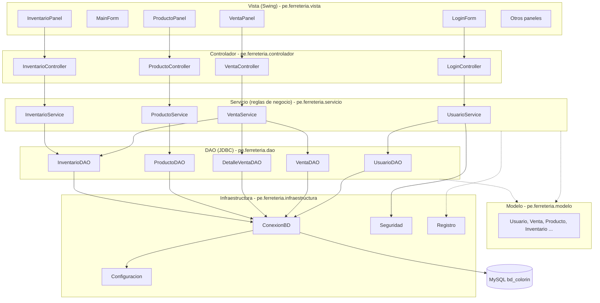
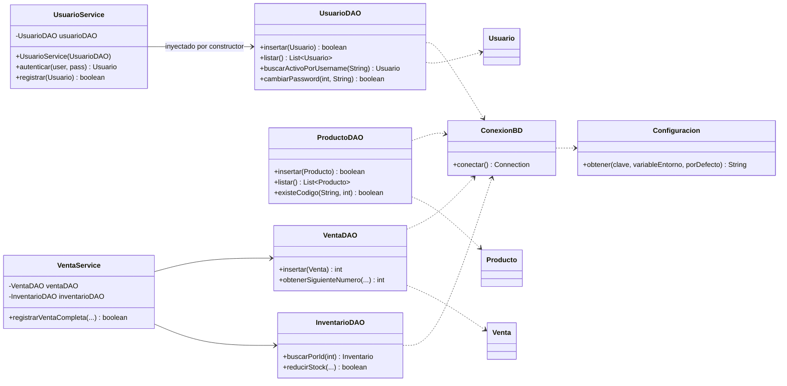
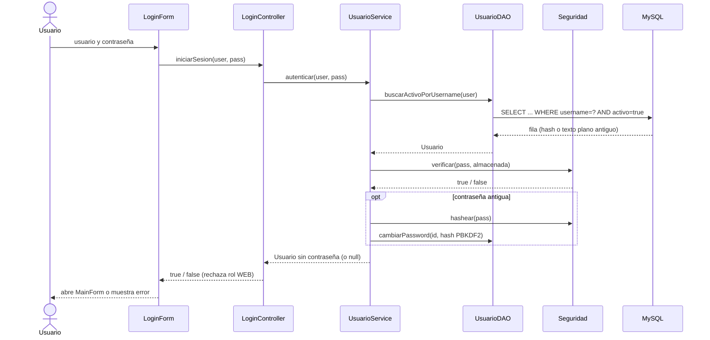
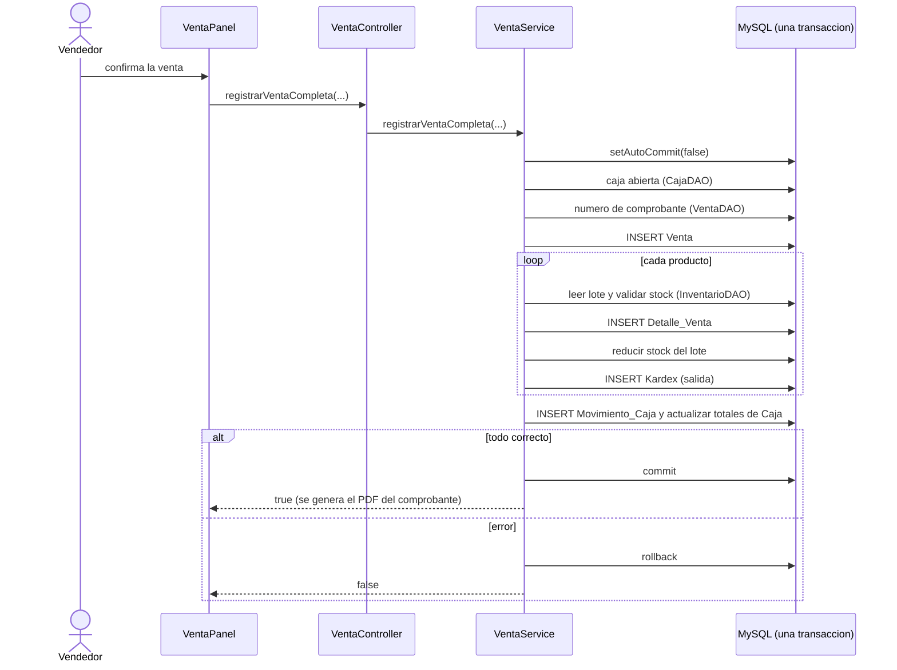
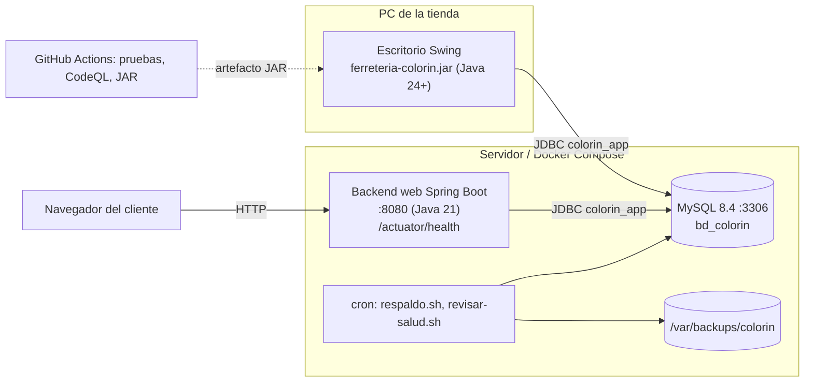

# Diagramas de arquitectura – SGIVFC

Los diagramas se escriben en Mermaid (`src/*.mmd`), GitHub los muestra directamente y los PNG se generan con `mmdc -i src/x.mmd -o x.png -s 2`.

## 1. Arquitectura en capas (MVC)

**Vista** (Swing) solo presenta y captura datos; **Controlador** traduce acciones a llamadas de servicio; **Servicio** contiene las reglas de negocio y las transacciones; **DAO** ejecuta las consultas JDBC; **Modelo** son las entidades. `ConexionBD` y `Configuracion` aíslan la conexión y sus credenciales.

## 2. Patrón DAO e inyección de dependencias

## 3. Secuencia: inicio de sesión (con hash PBKDF2)

## 4. Secuencia: registrar una venta (transacción)

## 5. Despliegue

## 6. Principios SOLID en el proyecto
| Principio | Dónde se aplica | Evaluación |
|-----------|-----------------|-----------|
| **S** – Responsabilidad única | Cada capa tiene una función: `*DAO` (datos), `*Service` (reglas), `*Controller` (puente), `*Panel` (UI); `Seguridad` solo maneja contraseñas; `Configuracion` solo lee configuración; `Registro` solo logs. | Cumple en general. **Mejora:** `VentaService.registrarVentaCompleta` concentra validación, transacción, stock, Kardex y caja en un método de ~700 líneas; conviene dividirlo en pasos privados o servicios. |
| **O** – Abierto/cerrado | Nuevos reportes se agregan como clases `*Reporte` y generadores PDF sin modificar los existentes. | Parcial: agregar un método de pago o un tipo de comprobante exige modificar `VentaService`. **Mejora:** estrategia por tipo de comprobante. |
| **L** – Sustitución de Liskov | Las pruebas sustituyen los DAO por dobles de Mockito (subclases) sin cambiar el comportamiento esperado del servicio. | Cumple en el uso actual; no hay jerarquías de herencia propias. |
| **I** – Segregación de interfaces | Servicios y controladores exponen solo las operaciones de su módulo. | Parcial: los DAO son clases concretas, no interfaces. **Mejora:** definir interfaces (`UsuarioRepositorio`, …). |
| **D** – Inversión de dependencias | Los servicios reciben sus DAO por constructor (`UsuarioService(UsuarioDAO)`, `VentaService(...)`), con constructor sin argumentos que usa los DAO reales. Permite pruebas unitarias. | Cumple parcialmente: depende de clases concretas, no de interfaces; los controladores crean su servicio con `new` en el constructor por defecto. |

Este análisis reconoce explícitamente lo que no se cumple para planificar la refactorización y para el informe.
